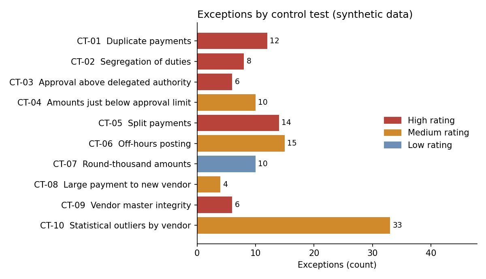

# Audit Analytics: Full-Population Control Testing

Internal audit increasingly tests **every** transaction rather than a sample. This project builds that workflow
end to end on synthetic data: SQL control tests over a year of accounts-payable payments, statistical screens
(Benford's Law, vendor-level outliers), audit workpapers for each test, a findings memo, and an exception dashboard.
A second module evaluates transaction-monitoring (AML) rules against labelled synthetic transactions.

> **All data is synthetic.** The ledger is generated by code in this repository with a known number of planted
> issues. Nothing here describes a real organisation, bank, vendor or person, and the outputs are not an audit opinion.



## Business question
Would a bank's payment controls stop duplicate payments, self-approval, approvals above delegated authority and
split payments? If internal audit tests the full population, which exceptions does it find, and how reliable are
the tests themselves?

## Results (from the committed run, seed 2027)
- **5,036 payments** (CAD 53.9M, Jan to Dec 2025) tested with **10 tests**: 5 key-control tests and 5 risk indicators.
- **94 payments** were flagged by at least one test; 5 high-rated tests returned exceptions
  (duplicates, segregation of duties, approval above authority, split payments, vendor master).
- **Known-answer validation:** each of the 9 SQL tests found exactly the issues planted for it (0 missed,
  0 false flags). The statistical outlier test found all 5 planted outliers, plus 24 large payments planted for other
  tests and 4 clean records.
- **Benford first-digit test:** MAD = 0.0050, close conformity (Nigrini). Shown as a population screen only.
- **AML rule evaluation:** code and tests are complete; results on the IBM dataset are not reported yet
  (needs the Kaggle download, see [data/README.md](data/README.md)).

Full write-up: [reports/audit_findings_memo.md](reports/audit_findings_memo.md) ·
Workpapers: [workpapers/](workpapers/)

## Control tests

| ID | Test | Type | Rating | How |
|---|---|---|---|---|
| CT-01 | Duplicate payments | Control | High | Window function (`LAG`) over vendor + amount; same invoice or within 30 days |
| CT-02 | Segregation of duties | Control | High | Creator = approver |
| CT-03 | Approval above delegated authority | Control | High | Join to approver's limit |
| CT-04 | Amounts just below approval limit | Indicator | Medium | 95%-100% of approver's limit |
| CT-05 | Split payments | Control | High | Same vendor, day and approver; each under limit, total over it |
| CT-06 | Off-hours posting | Indicator | Medium | Weekend or 20:00-05:59 |
| CT-07 | Round-thousand amounts | Indicator | Low | Exact multiples of $1,000, $5,000+ |
| CT-08 | Large payment to new vendor | Indicator | Medium | Over $50,000 within 30 days of vendor creation |
| CT-09 | Vendor master integrity | Control | High | Vendor missing from master, or paid after deactivation |
| CT-10 | Statistical outliers by vendor | Indicator | Medium | Robust z-score (median/MAD) on log amount, z > 3.5 |

SQL lives in [`sql/control_tests/`](sql/control_tests/), one file per test, each with its control objective in the header.

## How it works

```
generate_ledger.py ──► data/generated/*.csv ──► SQLite (in memory)
   (clean population                                │
    + planted issues)                               ├─► sql/control_tests/*.sql ─┐
                                                    ├─► vendor outliers (Python) ├─► outputs/exceptions.csv
                                                    └─► Benford (Python)        ─┘        │
                                                                                          ├─► workpapers/*.md
planted_issues.csv ──────────────── known-answer validation ──────────────────────────────├─► reports/audit_findings_memo.md
                                                                                          ├─► images/*.png
                                                                                          └─► app/dashboard.py
```

**Why plant issues?** A control test is itself a control. Generating a clean population and planting a known
number of each issue gives every test a known answer, so `pytest` can prove the SQL finds all of them and
nothing else.

## Workpaper format
Each test has a one-page workpaper ([example](workpapers/CT-05_split_payments.md)): control objective, risk,
population, procedure with a link to the query, results with the known-answer check, the first 10 exceptions,
conclusion, follow-up procedure and recommended management action.

## Transaction-monitoring rules (AML)
[`src/audit_analytics/aml.py`](src/audit_analytics/aml.py) runs five simplified monitoring rules on the IBM synthetic
AML dataset and compares the flags with its `Is Laundering` label: structuring (3+ payments of 8,000-9,999 within a
rolling 24 hours), fan-out, fan-in, rapid pass-through, and large cash. For each rule it reports flags, true and
false positives, precision, recall and lift over the base rate. The thresholds are illustrative and are not any
bank's actual rules.

## Run it

```bash
python -m venv .venv && source .venv/bin/activate
pip install -r requirements.txt
export PYTHONPATH=src

python -m audit_analytics.pipeline --regenerate   # data, tests, workpapers, memo, charts
pytest -q                                          # known-answer and edge-case tests
streamlit run app/dashboard.py                     # exception dashboard

# optional, after downloading HI-Small_Trans.csv into data/raw/
python -m audit_analytics.aml && python -m audit_analytics.pipeline
```

## Repository layout

```
src/audit_analytics/   generator, test runner, statistics, AML rules, pipeline
sql/control_tests/     one SQL file per control test
tests/                 pytest: known-answer, boundary and AML fixture tests
workpapers/            generated workpaper per test
reports/               generated findings memo
outputs/               exceptions, summary, completeness and Benford tables (CSV)
images/                charts used in the README and memo
app/                   Streamlit dashboard
data/                  generated ledger (committed) and data/raw for the Kaggle file (ignored)
```

## Tech stack
Python (pandas, NumPy, SciPy, matplotlib), SQL (SQLite with window functions and CTEs), pytest,
Streamlit, GitHub Actions.

## Limitations
- The clean population is built to pass every test, so real data would produce more noise and judgement calls.
- Thresholds (30-day duplicate window, 95% near-limit band, $50,000 new-vendor amount, z > 3.5) are illustrative;
  in practice they are agreed with management and calibrated on history.
- The tests find patterns, not intent. Every exception needs follow-up evidence before it becomes a finding.
- Benford's Law is a population-level screen and says nothing about an individual payment.

## Data and licence
See [data/README.md](data/README.md). Code is released under the MIT licence.
