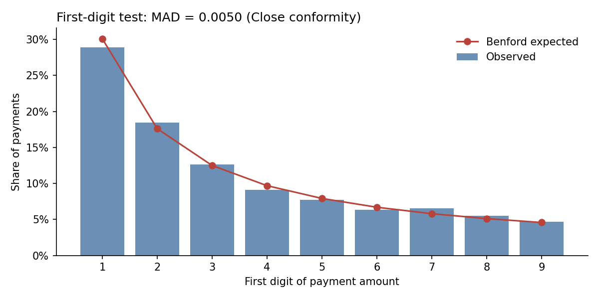

# Audit findings memo: accounts-payable payment controls

**Scope:** synthetic accounts-payable ledger, payments posted 1 Jan to 31 Dec 2025
**Prepared:** 2026-11-17, generated from pipeline outputs
**Important:** all data is synthetic and was generated with planted issues. This memo demonstrates
audit-analytics methods. It is not an audit opinion and does not describe any real organisation.

## 1. Summary
Ten tests were run on the full population of 5,036 payments rather than a sample.
5 tests check key controls and 5 are risk indicators
that need follow-up before any conclusion. 5 high-rated tests returned exceptions.

| Test | Name | Type | Rating | Exceptions | Flagged amount (CAD) |
|---|---|---|---|---|---|
| CT-01 | Duplicate payments | Control | High | 12 | 101,975.67 |
| CT-02 | Segregation of duties | Control | High | 8 | 63,416.91 |
| CT-03 | Approval above delegated authority | Control | High | 6 | 852,436.84 |
| CT-05 | Split payments | Control | High | 14 | 1,353,367.60 |
| CT-09 | Vendor master integrity | Control | High | 6 | 37,295.44 |
| CT-04 | Amounts just below approval limit | Indicator | Medium | 10 | 2,739,690.27 |
| CT-06 | Off-hours posting | Indicator | Medium | 15 | 118,576.47 |
| CT-08 | Large payment to new vendor | Indicator | Medium | 4 | 496,547.83 |
| CT-10 | Statistical outliers by vendor | Indicator | Medium | 33 | 5,563,562.05 |
| CT-07 | Round-thousand amounts | Indicator | Low | 10 | 191,000.00 |

## 2. Key findings (high rating)
1. **Duplicate payments (CT-01)**: 12 payments, CAD 101,975.67. Add a hard stop in the payment system on vendor + invoice number + amount, and run this query before each payment run.
2. **Segregation of duties (CT-02)**: 8 payments, CAD 63,416.91. Configure the workflow to block self-approval and review AP Supervisor role access quarterly.
3. **Approval above delegated authority (CT-03)**: 6 payments, CAD 852,436.84. Enforce limits in the workflow so payments above an approver's limit route to the next level.
4. **Split payments (CT-05)**: 14 payments, CAD 1,353,367.60. Add a same-vendor, same-day aggregation check to the approval workflow.
5. **Vendor master integrity (CT-09)**: 6 payments, CAD 37,295.44. Add a referential-integrity check so payments cannot be released to missing or inactive vendors.

Indicator flags (near-limit amounts, off-hours posting, round amounts, new-vendor payments and statistical
outliers) should be vouched to invoices and approvals before they are reported as findings.

## 3. Population completeness
Checks performed before testing:

| check | result |
|---|---|
| Payment records | 5,036 |
| Total amount (CAD) | 53,939,358.33 |
| Posting period | 2025-01-01 to 2025-12-31 |
| Duplicate payment_id | 0 |
| Missing values in required fields | 0 |
| Non-positive amounts | 0 |
| Vendors in master | 157 |
| Employees in master | 20 |

## 4. Did the tests work? Known-answer validation
The generator plants a known number of each issue into an otherwise clean ledger. A test passes only if it
finds every planted issue of its type. The outlier test (CT-10) is statistical, so it also flags
large payments planted for other tests and a few clean records; those are shown separately.

| Test | Planted | Found | Missed | Other planted issues flagged | Clean records flagged |
|---|---|---|---|---|---|
| CT-01 | 12 | 12 | 0 | 0 | 0 |
| CT-02 | 8 | 8 | 0 | 0 | 0 |
| CT-03 | 6 | 6 | 0 | 0 | 0 |
| CT-04 | 10 | 10 | 0 | 0 | 0 |
| CT-05 | 14 | 14 | 0 | 0 | 0 |
| CT-06 | 15 | 15 | 0 | 0 | 0 |
| CT-07 | 10 | 10 | 0 | 0 | 0 |
| CT-08 | 4 | 4 | 0 | 0 | 0 |
| CT-09 | 6 | 6 | 0 | 0 | 0 |
| CT-10 | 5 | 5 | 0 | 24 | 4 |

## 5. Benford's Law (first digit)
5,036 payments of $10 or more. Chi-square = 13.67 (8 df), p = 0.091; mean absolute deviation
= 0.0050, which is **close conformity** on Nigrini's scale. The planted issues are too few to move
the overall distribution, so Benford is shown as a population-level screen, not as evidence about any payment.

## 6. Transaction-monitoring rules on labelled AML data
_Not run yet._ Download `HI-Small_Trans.csv` (see `data/README.md`) and run `python -m audit_analytics.aml`, then re-run the pipeline. No AML results are reported until they come from a real run.

## 7. Limitations
- Synthetic data: the clean population is built to pass every test, so real data would produce more noise.
- Thresholds (30-day duplicate window, 95% near-limit band, $50,000 new-vendor amount, z > 3.5) are
  illustrative and would be set with management in a real engagement.
- Tests find patterns in data; they do not show intent. Each exception needs follow-up evidence.
